# Clawdmeter


Clawdmeter puts your Claude Code usage on a small screen on your desk.
An ESP32 board shows your session and weekly limits. A desktop app reads
usage through Claude Code and sends it over Bluetooth.

Clawd lives on the device. With Claude Code hooks installed, he reacts to
prompts, performs after a busy stretch, and gets your attention when a
session needs an answer. When things go quiet, he settles into a screensaver.


## Get started

You need a supported board, a USB data cable, Bluetooth, and Claude Code
installed and signed in to an account that reports usage limits.

### 1. Install the desktop app

Download your OS archive from the [latest release](https://github.com/HermannBjorgvin/Clawdmeter/releases/latest).

| OS | Install |
| --- | --- |
| Linux | Unpack `clawdmeter-<version>-linux-x86_64.tar.gz` and put `clawdmeter` on your `PATH`, such as `~/.local/bin`. Bluetooth requires BlueZ and a D-Bus session. The tray needs a StatusNotifierItem host; GNOME needs the AppIndicator extension. |
| macOS | Unpack `clawdmeter-<version>-macos-universal.tar.gz` and move `Clawdmeter.app` to `/Applications`. The app is not notarized. On first launch, right-click and choose **Open**, then allow Bluetooth access. |
| Windows | Unpack `clawdmeter-<version>-windows-x86_64.zip` into a permanent folder and run `clawdmeter.exe`. SmartScreen may flag the unsigned app on first launch. |

Launch Clawdmeter to open setup. The app stays in the tray or macOS menu
bar. Without a tray, it uses a window; closing that window quits the app.

The window has six pages: **Overview**, **Device**, **Flash**, **Accounts**,
**Hooks**, and **Settings**. You can skip setup and return through **Run
setup again**.

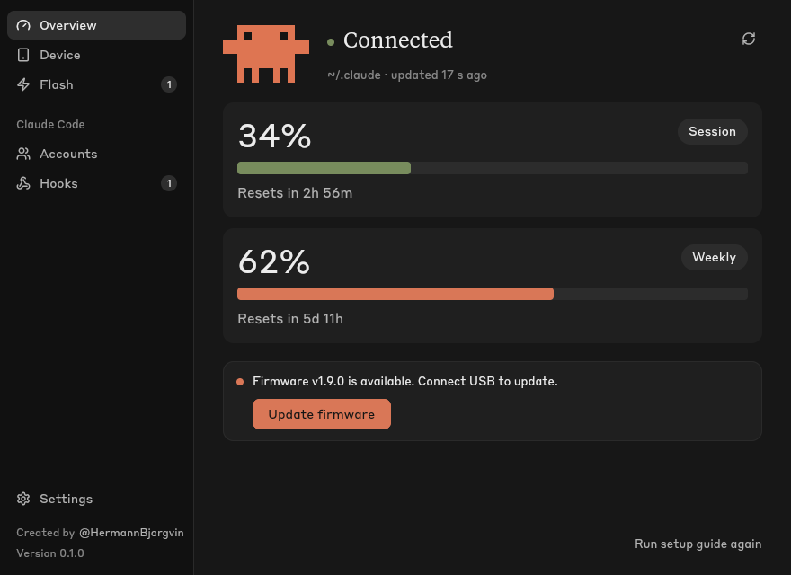

### 2. Install firmware

Connect the board over USB and follow setup, or open **Flash**. The app
identifies the chip, asks you to choose a board when needed, downloads the
matching firmware, and verifies its checksum before writing. Check the
board selection before starting. Keep the cable connected during the write.

A firmware update preserves Bluetooth pairing. If the board already runs
the latest release, you can continue without writing it again. On Linux,
the flasher reports serial-port permission problems and how to resolve them.

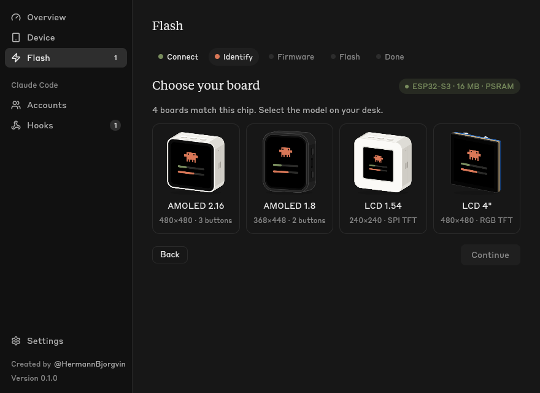

For a browser-based flash, download the board's merged `<env>-<version>.bin`
from the release. In Chrome or Edge, open [Espressif's web flasher](https://espressif.github.io/esptool-js/),
connect the board, select the image at address `0x0`, and choose **Program**.

### 3. Pair over Bluetooth

Pair **Clawdmeter** in your computer's Bluetooth settings. It appears as a
keyboard because its buttons send key presses.

- Linux: use the desktop Bluetooth settings, or run `bluetoothctl`, then
  `scan on`, `pair <MAC>`, and `trust <MAC>`.
- macOS: System Settings → Bluetooth → **Connect** next to Clawdmeter.
- Windows: Settings → Bluetooth & devices → Add device → Bluetooth → Clawdmeter.

For normal operation, the app looks for an OS-known Clawdmeter rather than
connecting to arbitrary nearby devices. On boards with a software-controlled
PWR button, hold it for about 3 seconds, then release to clear the device's
Bluetooth bonds. The LCD-4's PWR key resets the board; it does not clear pairing.

### 4. Add Claude Code hooks

Open **Hooks**, select the accounts to update, and review the changes to
`settings.json` before saving. Existing files are backed up to
`settings.json.bak`. Other hooks remain in place.

Hooks let Clawd react to activity and show alerts. The local event log
contains timestamps, event types, and session IDs. Alerts also store the
notification message or the first question from `AskUserQuestion`, which
is sent to the device. Prompt text and full tool-call payloads are not
written to the event log.

Usage meters work without hooks. Use **Send a test alert** to check the
app-to-device alert path; it does not test whether Claude Code invoked a hook.

### 5. Start at login

Enable **Settings → Start at login** to launch the tray app when you sign in.
The app uses XDG autostart on Linux, a LaunchAgent on macOS, and a user Run
entry on Windows.

## On the device

| Meters | Show | Screensaver | Attention |
| --- | --- | --- | --- |
| 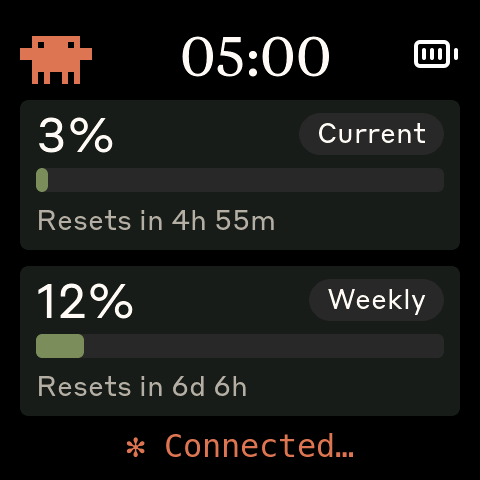 | 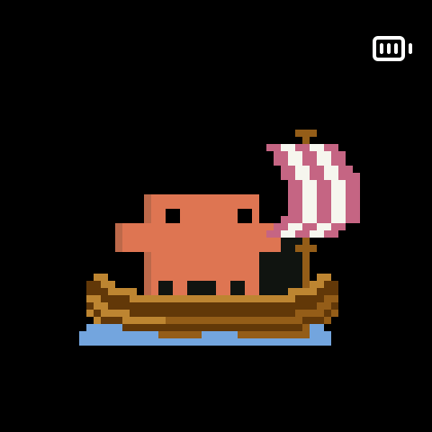 |  | 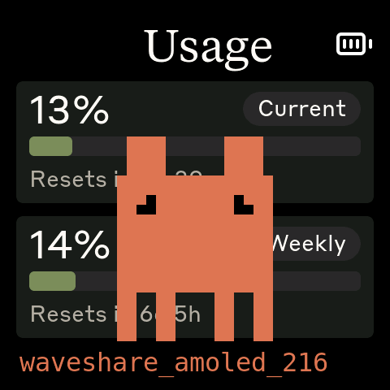 |
| Session and weekly usage | After sustained activity | After a quiet stretch | A session needs an answer |

The device boots to the meters. Tap a show or screensaver to return to them.
Tap the meters to bring Clawd's face up to the glass; tap again to send him
back. A tap that wakes a sleeping panel only wakes it.

Attention alerts end when you answer, tap the screen, or reach the two-minute
timeout. C6 boards show the message without the full-size Clawd. Optional
beeps and reset chimes work on boards with an implemented audio output.
**Minimal display** keeps the meters and a still Clawd, with no animated scenes.

The status line rotates through Claude Code's whimsical thinking verbs when
all is well. It shows **Waiting** without a connection, **No data** before a
reading, and **Stale** when the retained reading is old. The verbs are a
healthy-status indicator, not a report of an active model request. Minimal
display uses fixed status text.

If updates stop, the meters dim. The last reading is retained rather than
replaced with zero. See [Clawd's director](docs/clawd-director.md) for timing
and character rules.

### Buttons

| Button | Action |
| --- | --- |
| BOOT | Hold to send Space to the focused window, for Claude Code voice input. GPIO 0 on S3; GPIO 9 on C6. |
| Secondary, where fitted | Send Shift+Tab to the focused window. S3 2.16: GPIO 18; C6 2.16: GPIO 10; LCD-1.54: GPIO 5. |
| PWR, where software-controlled | Short press: next scene on the stage, brightness elsewhere. Hold about 3 seconds and release: clear pairing. |

The LCD-4 has one user button, BOOT. Its PWR key is a hardware reset.

## Supported boards

| | Board | |
| :-: | --- | --- |
| 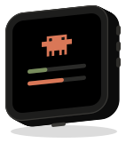 | [Waveshare ESP32-S3-Touch-AMOLED-2.16](https://www.waveshare.com/esp32-s3-touch-amoled-2.16.htm?&aff_id=149786) | 480×480 AMOLED, 3 buttons, speaker. Original board. |
| 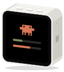 | [Waveshare ESP32-C6-Touch-AMOLED-2.16](https://www.waveshare.com/esp32-c6-touch-amoled-2.16.htm?&aff_id=149786) | 480×480 AMOLED on the ESP32-C6 (no PSRAM; animated corner Clawd, text-only attention alerts). |
| 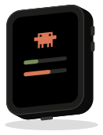 | [Waveshare ESP32-S3-Touch-AMOLED-1.8](https://www.waveshare.com/esp32-s3-touch-amoled-1.8.htm?&aff_id=149786) | 368×448 AMOLED, 2 buttons, speaker. |
| 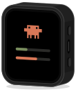 | [Waveshare ESP32-C6-Touch-AMOLED-1.8](https://www.waveshare.com/esp32-c6-touch-amoled-1.8.htm?&aff_id=149786) | 368×448 AMOLED on the ESP32-C6. |
| 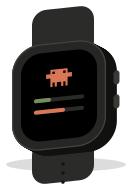 | [Waveshare ESP32-S3-Touch-AMOLED-2.06](https://www.waveshare.com/esp32-s3-touch-amoled-2.06.htm?&aff_id=149786) | 410×502 AMOLED in a watch case. |
|  | [Waveshare ESP32-S3-Touch-LCD-1.54](https://www.waveshare.com/esp32-s3-lcd-1.54.htm?sku=33869&aff_id=149786) | 240×240 IPS, 3 buttons, speaker. Smallest supported display. |
| 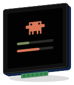 | [Waveshare ESP32-S3-Touch-LCD-4](https://www.waveshare.com/esp32-s3-touch-lcd-4.htm?&aff_id=149786) | 480×480 IPS, 4 inches, one button. |


Waveshare links include the owner's affiliate code.

Before starting a port, check for an existing pull request for that board.
Testing the same hardware helps more than a duplicate port. See the
[porting guide](docs/porting/adding-a-board.md) and [HAL contract](docs/porting/hal-contract.md).

## Settings and files

On Linux and macOS, config and state live in `~/.config/clawdmeter/`.
On Windows, they live in `%LOCALAPPDATA%\Clawdmeter\`.
The config file is `~/.config/clawdmeter/config` on Linux and macOS, or
`%LOCALAPPDATA%\Clawdmeter\config` on Windows. It uses `key = value` lines. The app reloads it every few
seconds and preserves comments and unknown keys when saving.

| Key | Default | Effect |
| --- | --- | --- |
| `config_dirs` | `~/.claude` | Comma-separated Claude Code config folders. The app selects the account whose session usage increased most recently. `CLAUDE_CONFIG_DIR` supplies the default when this key is absent. |
| `chime` | `off` | Play a reset chime on supported audio hardware. |
| `beep` | `off` | Play a sound with attention alerts on supported audio hardware. Tray mute lasts until restart. |
| `clock` | `off` | `auto`, `12`, or `24` replaces the device's Usage title with a clock. |
| `poll_interval` | automatic | Override working and no-hooks polling intervals, in seconds. The scheduler enforces at least 120 seconds per account. Quiet and other-account schedules still apply. |
| `heartbeat_interval` | `60` | Resend cached readings between usage checks. This does not fetch usage. Keep the default unless diagnosing the connection. |
| `claude_path` | found on `PATH` | Full path to the Claude Code executable, if detection fails. |
| `update_check` | `on` | Check for firmware releases daily. |
| `alert_on` | `permission, question, elicitation` | Which waits alert on the device and tray: `permission`, `question`, `idle`, `elicitation` (MCP input), or `none`. Set on the Hooks page. Other notification types follow `permission`. |
| `release_repo` | `HermannBjorgvin/Clawdmeter` | GitHub repository used for firmware releases. |
| `onboarding_done` | unset | `true` after setup is finished or skipped. |

The tray app writes `daemon.log` in the state folder and keeps the previous
run as `daemon.log.1`. **Settings** links to the log and config file.

### Refresh timing

The app runs `claude --output-format json -p /usage` for each account.
It parses Claude Code's usage output; Clawdmeter does not make its own
model request or read OAuth credentials directly.

With hooks, the shown account is checked after a prompt, every 3 minutes
while working, and about 10 seconds after a turn stops. Checks fall to every
5 minutes during the first 10 quiet minutes, then every 15 minutes. Without
hooks, checks run every 5 minutes. Other accounts are checked every 10 minutes.

Every trigger, including manual refresh, respects a two-minute minimum gap
and any retry delay. Transient failures delay retries by 10, 20, then 30
minutes. A failed check never becomes a zero reading. Heartbeats stop once
the selected reading is stale, allowing the device to show the loss of fresh data.

### Command line

```text
clawdmeter                      Run the tray app
clawdmeter --daemon             Run without a tray or window
clawdmeter --once               Read usage once and print the payload; no Bluetooth
clawdmeter --window [PAGE]       Open overview, device, flash, accounts, hooks, settings, or setup
clawdmeter --ports              List attached Espressif USB ports
clawdmeter --info PORT          Read the board and firmware version over USB
clawdmeter hook MODE [event]    Handle a Claude Code hook: alert, clear, or event
```

`CLAWDMETER_LOG=debug` enables debug logs. `CLAWDMETER_NO_TRAY=1` uses a
window instead of a tray icon. `CLAWDMETER_BLE_ADDRESS` selects the paired
device address to try first.

## Replacing a legacy daemon

The desktop app replaces the bash and Python daemons. It uses only the
current state folder and ignores the legacy directory. Set up accounts
and preferences in the app.

1. Install the desktop app. If **Settings** reports a legacy service,
   disable it there so only one process talks to the device. On Windows,
   also quit the Python tray or sign out to stop the running process.
2. Open **Hooks** and update entries that use `attention-hook.sh`. Review
   the file changes before saving.
3. Remove the legacy checkout's `daemon/.venv` if you no longer need it.

See [daemon parity](docs/daemon-parity.md) for platform details and retained behavior.

## Data flow

Usage readings and hook events reach the app independently. The app selects
an account, builds a JSON payload, and writes it to the device over Bluetooth
LE. The firmware updates the meters and passes activity to Clawd's director.
Keyboard button reports use the separate HID service.

## BLE protocol

The device advertises a custom GATT service next to the standard HID keyboard service:

|                                | UUID                                   |
| ------------------------------ | -------------------------------------- |
| **Data service**               | `4c41555a-4465-7669-6365-000000000001` |
| RX characteristic (write)      | `4c41555a-4465-7669-6365-000000000002` |
| TX characteristic (notify)     | `4c41555a-4465-7669-6365-000000000003` |
| REQ characteristic (notify)    | `4c41555a-4465-7669-6365-000000000004` |
| **HID service**                | `00001812-0000-1000-8000-00805f9b34fb` |

The host writes one JSON object (at most 512 bytes) to RX; every write is a complete update. The device notifies `0x01` on REQ when it has no data yet, asking for a poll.

```json
{"s":45,"sr":120,"w":28,"wr":7200,"st":"allowed","acct":"pro","ok":true,"a":2,"e":"p","es":14,"n":1}
```

| Field | Meaning |
| --- | --- |
| `s`, `w` | Session and weekly % used. |
| `sr`, `wr` | Minutes until each resets; `-1` = window not started / unknown. |
| `st` | `allowed`, `limited` or `overage` (stored, not shown). |
| `acct` | `pro`, or `ent` for a spend-capped account: `s` is then the spend %, and `tp` (% of the billing period elapsed), `pd` (period length in days) and `rd` (reset date, e.g. `"Nov 1"`) fill the second card. |
| `t`, `tf` | Local wall-clock epoch and 12/24-hour format, when the clock is on. |
| `c` | `1` = the reset chime may sound. |
| `ok` | `false` alone = no usable account data; do not treat this as a zero reading. |
| `b`, `m`, `x` | Attention: beep, message (ASCII), end the alert. |
| `a`, `e`, `es`, `n` | Fast clock: activity 0–3, latest hook event (`p` prompt, `s` stop, `b` back after a gap) and its sequence number, active sessions. |
| `rp` | `1` = a heartbeat replay, not a fresh poll; the rate math skips it. |

## Build from source

Firmware uses PlatformIO. Select the environment for your board:

```bash
pio run -d firmware -e waveshare_amoled_216
pio run -d firmware -e waveshare_amoled_216 -t upload --upload-port /dev/ttyACM0
pio test -d firmware -e native
```

Environments are listed in `firmware/platformio.ini`. macOS ports use
`/dev/cu.usbmodem*`; Windows ports use `COMn`. A bare `pio run -d firmware`
builds the default hardware environments and simulator.

The desktop app uses Rust 1.90 or newer. Install the Linux packages listed
in [the build dependency action](.github/actions/linux-desktop-deps/action.yml), then:

```bash
cd desktop
cargo run -p clawdmeter-app --release
cargo test --workspace
```

The workspace separates usage/configuration (`clawdmeter-core`), Bluetooth
(`clawdmeter-ble`), firmware downloads and flashing (`clawdmeter-flash`), and
the tray, GPUI window, and hook integration (`clawdmeter-app`).

## Development and releases

Use the [firmware simulator](SIM-USAGE.md) to review layouts and Clawd's
behavior without hardware. Font generation is documented in
[fonts.md](docs/fonts.md). Desktop reference images are in
[desktop/docs/screenshots](desktop/docs/screenshots/).

The [release workflow](.github/workflows/release.yml) accepts tags in the
form `vMAJOR.MINOR.PATCH`, with an optional prerelease suffix. It builds
merged board images for address `0x0`, desktop archives, checksums, a
`manifest.json` for the app, and ESP Web Tools manifests. Tags with a
hyphen publish prereleases, which the normal update check ignores.

A new board needs a display-name entry in `tools/ci/make_manifest.py` as
well as its firmware environment and desktop board assets. Firmware CI
builds the boards, runs native tests, and captures the simulator. Desktop
CI runs formatting, linting, and workspace tests on Linux, plus core tests
on macOS and Windows.

## Credits

- Pixel-art Clawd animations are Anthropic's official mascot art (claude.ai/code, Claude Code desktop), archived and converted by the tooling in `tools/` and `research/clawd-official/`.
- The original macOS daemon and flash helper were ported by [Chris Davidson (@lorddavidson)](https://github.com/lorddavidson).
- Lucide icon set ([lucide.dev](https://lucide.dev), MIT) for the Bluetooth, battery and USB glyphs.
- Anthropic brand fonts (Tiempos Text, Styrene B); see the asset notice below.

## Asset licensing

This repository includes Anthropic's proprietary fonts and copyrighted
Clawd artwork. The project does not have permission to redistribute those
assets. The owner has not assigned a copyleft license to this repository;
do not assume that its code and bundled assets share a license. Review the
asset rights before copying or redistributing them.

## Related project

[Beam](https://github.com/notaharness/beam) pairs machines using a passkey
and [Tailscale's tailcat](https://tailscale.com/blog/tailcat).
